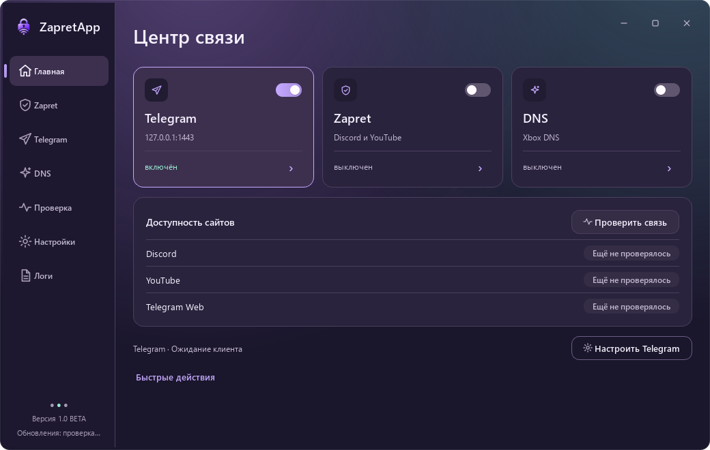

# ZapretApp

**ZapretApp** — приложение для Windows 10 и 11 (x64), которое помогает настроить доступ к Discord, YouTube и Telegram. В одном окне можно выбрать стратегию Zapret для своей сети, подключить Telegram Desktop к локальному прокси и проверить связь. Интерфейс доступен на русском и английском.



## Установка

1. Откройте **Releases** на странице репозитория. В последнем релизе под заголовком **Assets** скачайте **ZapretApp-1.0-BETA-Setup-r4.exe**.
2. Запустите установщик, выберите папку и, если нужен, ярлык на рабочем столе. Основные компоненты уже входят в установщик.
3. Запустите ZapretApp и выберите язык. Windows запросит права администратора для работы сетевого драйвера и изменения системных настроек.

## Как пользоваться

| Задача | Что сделать |
| --- | --- |
| Открыть Discord или YouTube | На вкладке **Zapret** нажмите **Подобрать автоматически** или выберите стратегию вручную. Дождитесь результата и проверьте видео или голосовой канал. |
| Подключить Telegram Desktop | Включите **Telegram** на главной, нажмите **Подключить Telegram** и подтвердите подключение в Telegram Desktop. На главной появится статус клиента. |
| Проверить связь | Нажмите **Проверить связь**. Приложение проверит ответы от Discord, YouTube и Telegram Web. У локального Telegram-прокси свой индикатор подключения. |
| Сменить DNS | Откройте вкладку **DNS**, выберите провайдера и включите настройку. Доступность конкретного сервиса зависит от сети и провайдера. |
| Обновить компоненты | На вкладке **Zapret** или **Telegram** проверьте наличие обновления. Фоновая загрузка добавляет версии в список. Активную версию можно выбрать вручную. |
| Отменить изменение | Нажмите **Вернуть как было** на вкладке компонента. Для Zapret вернётся предыдущий выбор стратегии и версии, для Telegram — предыдущая версия прокси. |
| Посмотреть изменения | Нажмите **Что нового**. Первая вкладка рассказывает о самом ZapretApp и работает без интернета. Рядом доступны заметки о релизах компонентов. |

## Запуск из исходного кода

Нужны Windows x64 и Python 3.12. Откройте PowerShell в корне репозитория и выполните команды.

```powershell
py -3.12 -m venv .venv
.\.venv\Scripts\python.exe -m pip install -r requirements.txt
.\.venv\Scripts\python.exe run.py
```

Код интерфейса находится в `app/ui`, управление компонентами — в `app`, встроенные компоненты — в `resources` и `vendor`. [Как собрать Windows-установщик](docs/BUILD.md)

## Основа проекта и лицензии

ZapretApp основан на [ZapretTG](https://github.com/tendo432/ZapretTG). Для Discord и YouTube используется [zapret-discord-youtube](https://github.com/Flowseal/zapret-discord-youtube), для Telegram — [tg-ws-proxy](https://github.com/Flowseal/tg-ws-proxy). Авторские уведомления сохранены. [Лицензия приложения](LICENSE) · [Лицензии сетевых компонентов и WinDivert](resources/zapret/LICENSE.txt) · [Лицензия Telegram-прокси](vendor/tgws/LICENSE)
